# Cofradía · Ajustes a la Fase 1 — especificación para desarrollo

> **YA IMPLEMENTADO (referencia).** Estos ajustes ya están en `develop`, excepto A-20 (pagos), que está fuera de esta fase. **No reimplementar.** Los cambios vigentes están en `AJUSTES_COFRADIA_FASE1_v2.md`.


**Cliente:** Cofradía SAS (vertical de café) · **Preparado por:** Blue · **Fecha:** 30 de octubre de 2026
**Base revisada:** rama `develop`, cliente de demostración «Cofradía (demo)», manual de usuario v1.0.
**Fuentes de verdad:** historias de usuario Fase 1 (HU-F1-01 a HU-F1-16), modelo de datos v2 y las decisiones de revisión del 30 de octubre.

---

## 0. Cómo usar este documento

Sugerencia: deja esta carpeta en `docs/cofradia-ajustes-fase1/` del repositorio.

**Instrucciones para el asistente de código (Claude):**

1. Implementa **un ajuste a la vez**, por su ID (por ejemplo: «implementa A-01 según `docs/cofradia-ajustes-fase1/AJUSTES_COFRADIA_FASE1.md`»).
2. **Conserva el sistema visual actual de la app** (componentes, colores, tipografía, botones). Las imágenes de `img/propuesta/` indican **qué contiene cada pantalla, en qué orden y cómo se comporta**, no su estilo.
3. Las cifras y nombres de las imágenes son **datos de ejemplo**.
4. No borres registros: la app **anula con motivo** y audita. Mantén ese patrón.
5. Las migraciones deben ser reversibles y no romper los datos de otros clientes de la plataforma (el vertical es multi-cliente).
6. Si una regla de este documento es ambigua o choca con el esquema actual, **pregunta antes de inventar**.
7. Al terminar cada ajuste, verifica sus **criterios de aceptación** y, cuando aplique, la prueba de punta a punta de la sección 6.

---

## 1. Principios transversales

| Tema | Regla |
| --- | --- |
| Vocabulario | Las dos líneas de negocio se nombran igual en toda la app: **Marca propia** (se compra, se procesa y se **vende**) y **Servicios a terceros** (trilla y maquila; se **remisiona**). Cada una con su etiqueta de color constante: verde para marca propia, caramelo para terceros. Reemplaza «Cliente», «Servicios (clientes)», «Producto terminado» donde aplique. |
| Formato de pesos | En pantalla, kilos con **1 decimal** (`156,0 kg`). Internamente se guardan 3 decimales. Hoy «194,000 kg» se lee como ciento noventa y cuatro mil. Porcentajes con 1 decimal; pesos colombianos sin decimales. |
| Alertas | Avisan, **nunca bloquean** el guardado (ya es así; mantenerlo). |
| Roles en Cofradía | Propietario/Administrador (el dueño es también el gerente) y Operativo. El rol **Gerencia** sigue existiendo en la plataforma, pero **no se asigna en Cofradía**. |
| Tablet | Controles de al menos 44 px, teclado numérico en pesos, nada que dependa de pasar el cursor (ya es así; mantenerlo). |

---

## 2. Backlog priorizado

**Ola 1:** corrige datos y conviene cerrarla antes de entregar a Cofradía. **Ola 2:** flujo y uso. **Ola 3:** alcance nuevo, que se estima aparte.

| ID | Ajuste | Tipo | Ola | Pantalla principal |
| --- | --- | --- | --- | --- |
| A-01 | Empaque sin bultos ni merma; diferencia clasificada | Corrección | 1 | Planta · proceso de empaque |
| A-02 | Bolsas de terceros de peso libre, sin descontar insumos | Ajuste | 1 | Planta · proceso de empaque |
| A-03 | Alerta de merma de dos lados; merma sobre lo procesado | Corrección | 1 | Planta · procesos, ficha del lote, panel |
| A-04 | Pesos con 1 decimal en pantalla | Ajuste | 1 | Toda la app |
| A-06 | Nombre del cliente en la pestaña del navegador y en el inicio de sesión | Corrección | 1 | Layout, login |
| A-05 | Costo de producir una libra, por lote y en el panel | Nueva historia (HU-F1-17) | 2 | Ficha del lote, panel, insumos |
| A-07 | Menú por el recorrido del café, Configuración y menú por rol | Ajuste | 2 | Barra lateral |
| A-08 | Recibir café: una sola entrada con tipo de ingreso | Ajuste | 2 | Nueva compra / Nueva recepción |
| A-09 | Temperatura y tiempo del cliente; orden de los campos | Ajuste | 2 | Recibir café |
| A-10 | Valor del servicio con los valores estimados marcados | Ajuste | 2 | Recibir café |
| A-11 | Hora de llegada automática | Ajuste | 2 | Recibir café, Planta, Lotes |
| A-12 | Tostión: aplicar a todos los baches; pesaje individual o agrupado | Ajuste | 2 | Planta · tostión |
| A-13 | Planta: una sola cola y columna «Por entregar» | Ajuste | 2 | Planta |
| A-14 | Entrega desde Planta, varios lotes por remisión, quién recibe | Corrección | 2 | Planta, remisión |
| A-15 | Inventario en tres pestañas | Ajuste | 2 | Producto terminado, Insumos |
| A-16 | Ventas marca propia directo al formulario; factura electrónica opcional | Ajuste | 2 | Ventas |
| A-17 | Ficha del lote: recorrido y dónde está el café | Ajuste | 2 | Ficha del lote |
| A-18 | Edición de lotes solo por el administrador, con historial | Dentro del alcance (HU-F1-11) | 2 | Ficha del lote |
| A-19 | Panel: costo por libra, por cobrar y avisos para decidir | Ajuste | 2 | Panel |
| A-20 | Estado de pago y «Remisiones a terceros · Por cobrar» | Cambio de alcance | 3 | Remisiones |

Rutas observadas en `develop` (pueden variar): `/dashboard/cafe` (panel), `/dashboard/cafe/lotes`, `/dashboard/cafe/lotes/nueva-compra`, `/dashboard/cafe/lotes/[id]`, `/dashboard/cafe/planta`, `/dashboard/cafe/planta/[id]`, `/dashboard/cafe/inventario`, `/dashboard/cafe/insumos`, `/dashboard/cafe/ventas`, `/dashboard/cafe/remisiones`, `/dashboard/cafe/maestros/tipos`, `/dashboard/terceros`, `/dashboard/tarifas`.

---

## 3. Especificación por ajuste

### A-01 · Empaque sin bultos ni merma; diferencia clasificada — Ola 1

**Hoy**
- El formulario de empaque muestra los bultos de la recepción (por ejemplo 60, 66 y 68 kg), aunque ese café ya se transformó.
- Pide «Peso de salida» y calcula «Merma de empaque».
- El sobrante sale del inventario como merma: en MP-2026-0001 se tostaron 205,0 kg y se empacaron 200,0 kg, se registró 2,4 % de merma y desaparecieron 5,0 kg de café.

**Debe quedar**
- No se muestran los bultos. La pantalla parte de **«Llega a empaque»**: el peso de salida del proceso anterior (tostión o molienda) que está pendiente de empacar.
- El operario registra **líneas de bolsas**: tamaño × cantidad. La suma se ve en vivo frente a lo que llega.
- **Diferencia** = llega − usado en bolsas. No es merma.
  - Si la diferencia es > 0, el operario elige su destino, con estas opciones:
    - Terceros: `se entrega suelto al cliente` · `muestra` · `pérdida`.
    - Marca propia: `queda a granel` · `muestra` · `pérdida`.
  - «Queda a granel» deja ese café como inventario de **tostado a granel** del lote (ver A-15).
  - Si la diferencia es < 0, error de validación: «Las bolsas suman más de lo que llega a empaque».
- El proceso de empaque **no genera registro de merma** ni entra en los promedios de merma del panel.
- Al registrar el último servicio de un lote de terceros, se muestra «Lote listo · ¿Entregar ahora?» con dos botones: **Entregar ahora** (abre A-14) y **Después** (el lote queda en «Por entregar»).

**Criterios de aceptación**
- [ ] El formulario de empaque no muestra bultos.
- [ ] Con 145,6 kg que llegan y 12 × 10 kg + 5 × 5 kg, muestra usado 145,0 kg y diferencia 0,6 kg, y exige elegir su destino.
- [ ] Con «queda a granel» (marca propia), el saldo aparece en Inventario › Marca propia › tostado a granel del lote.
- [ ] El panel ya no muestra «Empaque» en la merma por proceso.
- [ ] El total del lote cuadra: lo empacado más el granel, la muestra y la pérdida suma lo que llegó.

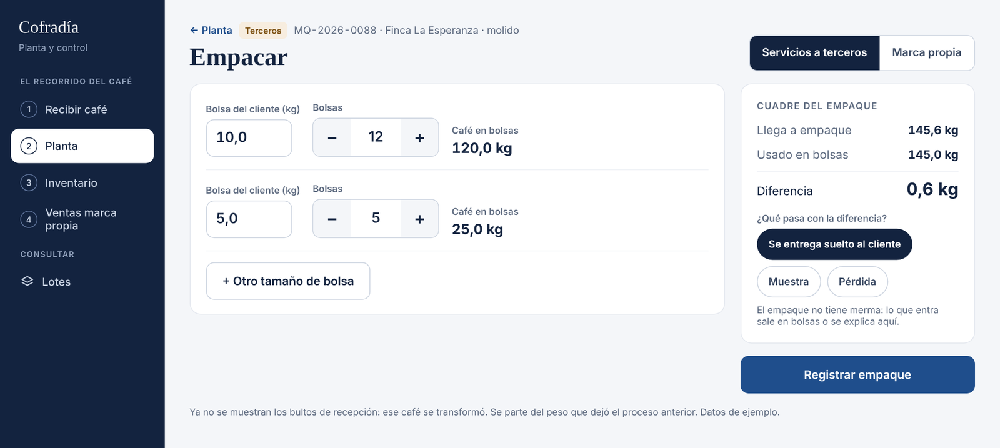
Vista actual: `img/actual/04-empaque.png`

---

### A-02 · Bolsas de terceros de peso libre, sin descontar insumos — Ola 1

**Debe quedar**
- **Servicios a terceros:** la bolsa es del cliente. Cada línea pide **peso de la bolsa (kg, libre)** y cantidad; por ejemplo 10 kg, 5 kg o 2,5 kg. **No** descuenta insumos de Cofradía.
- **Marca propia:** presentaciones de catálogo **500 g y 2.500 g**, cada una en **grano o molido**. Descuenta la bolsa y la etiqueta de esa presentación. Si la línea es «molido», la **molienda se registra en esta misma pantalla** como proceso de molienda del lote (entra X kg, sale Y kg, con su merma de molienda), sin pasar por otra pantalla.
- Se pueden agregar varias líneas («+ Otro tamaño de bolsa»).

**Criterios de aceptación**
- [ ] En un lote de terceros se pueden registrar bolsas de 10 kg y 5 kg, y no cambia el stock de insumos.
- [ ] En marca propia, 40 × 500 g en grano y 8 × 2.500 g molido descuentan 40 bolsas y etiquetas de 500 g y 8 de 2.500 g, y crean el proceso de molienda del molido.
- [ ] El inventario de marca propia queda separado por calidad × presentación × forma.

---

### A-03 · Alerta de merma de dos lados; merma sobre lo procesado — Ola 1

**Hoy**
- La alerta solo se activa si la merma supera la referencia.
- La app usa ±3 puntos de tolerancia, pero el modelo de datos v2 (confirmado por Cofradía) dice ±2.
- La «merma total» de la ficha divide por todo lo recibido: MP-2026-0001 muestra 13,33 % con 4 de 6 bultos procesados, cuando la merma real es 20 %.

**Debe quedar**

| Estado | Condición | Color | Texto |
| --- | --- | --- | --- |
| En rango | `|merma − referencia| ≤ tolerancia` | Gris (neutro, no verde) | «En rango» |
| Alta | `merma > referencia + tolerancia` | Rojo | «Revisar · alta» (posible sobretueste o pérdida) |
| Baja | `merma < referencia − tolerancia` | Ámbar | «Verificar · baja» (peso o desarrollo del tueste) |

- **Referencia por proceso y, en tostión, por nivel de tueste** (bajo, medio, alto), parametrizable en Configuración con fecha de vigencia. Mientras Cofradía entrega sus valores, los tres niveles usan la referencia actual (trilla 19 %, tostión 18 %).
- **Tolerancia única: ±2 puntos** (modelo de datos v2), parametrizable.
- Aplica por bache, por proceso y en el panel. Nunca bloquea.
- **Merma de un lote** = Σ(kg de entrada − kg de salida) / Σ kg de entrada, **solo sobre lo procesado**, y por proceso.

**Criterios de aceptación**
- [ ] Un bache de 13,5 → 11,8 kg en tueste medio (12,6 %) aparece en ámbar «Verificar · baja».
- [ ] Un bache de 13,5 → 10,6 kg (21,5 %) aparece en rojo «Revisar · alta».
- [ ] La ficha de un lote con 2 de 6 bultos tostados muestra la merma de esos 2 bultos, no la dividida por los 6.
- [ ] Cambiar la referencia de «tostión medio» afecta solo los procesos registrados después.

---

### A-04 · Pesos con 1 decimal en pantalla — Ola 1

- Mostrar kilos con 1 decimal en listados, fichas, Planta, remisión y panel. Las entradas de peso aceptan hasta 3 decimales, pero se muestran redondeadas a 1.
- No cambia el almacenamiento.

**Criterio:** [ ] Ninguna pantalla muestra kilos con 3 decimales («250,000 kg» pasa a «250,0 kg»).

---

### A-06 · Nombre del cliente en la pestaña y en el inicio de sesión — Ola 1

- Hoy la pestaña del navegador dice «Toca Lácteos» y el inicio de sesión «Finca Toca» estando dentro de Cofradía.
- Debe mostrar el nombre del cliente activo; en el login, el nombre neutro de la plataforma o el del cliente si se entra por su dirección.

**Criterio:** [ ] Dentro de Cofradía, la pestaña dice «Cofradía · <pantalla>».

---

### A-05 · Costo de producir una libra, por lote y en el panel — Ola 2 (HU-F1-17)

**Por qué:** es el primer dolor de la Fase 1, no había un costo real por lote. Una libra equivale a 500 g, la presentación principal.

**Cálculo (costo directo)**

```
merma_tostion_lote   = Σ(entrada − salida) / Σ entrada   (procesos de tostión del lote)
costo_kg_tostado     = precio_compra_kg_lote / (1 − merma_tostion_lote)
si es molido:          costo_kg_tostado = costo_kg_tostado / (1 − merma_molienda_lote)
costo_libra          = costo_kg_tostado × 0,5 + costo_unitario_bolsa_500 + costo_unitario_etiqueta_500
margen_libra         = precio_venta_500 − costo_libra
```

Ejemplo (Excelso): 30.000 / (1 − 0,183) × 0,5 + 900 = **$19.260**. Con precio de venta de $29.000, el margen es **$9.740 (33,6 %)**. Para 2.500 g: `costo_kg_tostado × 2,5 + bolsa y etiqueta de 2.500 g`.

**Dónde**
- **Ficha del lote (marca propia):** bloque «Cuánto nos cuesta producir una libra (500 g)» con el desglose (café, bolsa y etiqueta, costo, precio, margen) y la nota «Costo directo. Energía, gas, mano de obra y arriendo entran con el módulo de gastos».
- **Panel:** costo de producir una libra por calidad (Excelso y Consumo), como promedio ponderado por kilos de los lotes empacados en el periodo, frente al precio de venta, con el margen.

**Requisito previo:** registrar el **precio unitario** al comprar bolsas y etiquetas (hoy solo se registra la cantidad). El costo de insumo usado es el de la última compra o el promedio ponderado; recomendamos promedio ponderado.

**Criterios de aceptación**
- [ ] Un lote Excelso a $30.000/kg con 18,3 % de merma de tostión e insumos de $900 muestra $19.260 por libra.
- [ ] Si se registra otra tostión del lote, el costo se recalcula con la merma acumulada.
- [ ] El panel muestra el costo por libra de cada calidad para «Hoy», «Esta semana» y «Este mes».

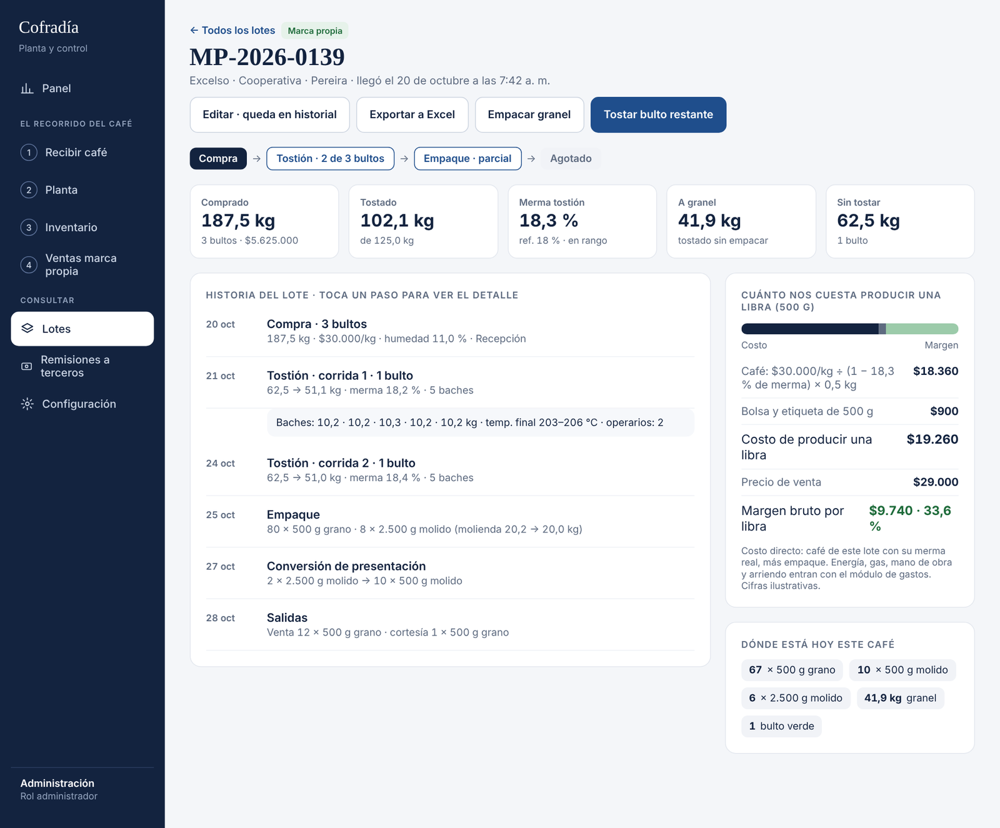

---

### A-07 · Menú por el recorrido del café, Configuración y menú por rol — Ola 2

**Hoy:** 12 opciones agrupadas por área (Operación, Inventario, Comercial, Gerencia, Maestros), iguales para todos los roles. El ingreso de café está escondido dentro de Lotes.

**Debe quedar**

```
Propietario / Administrador (aterriza en Panel)
  Panel
  EL RECORRIDO DEL CAFÉ
    1 Recibir café
    2 Planta
    3 Inventario
    4 Ventas marca propia
  CONSULTAR
    Lotes
    Remisiones a terceros
  Configuración   → pestañas: Tipos de café · Terceros · Tarifas y parámetros · Insumos · Recetas de tueste · Equipo

Operativo (aterriza en Planta, o en Recibir café si el usuario es de recepción)
  EL RECORRIDO DEL CAFÉ
    1 Recibir café · 2 Planta · 3 Inventario · 4 Ventas marca propia
  CONSULTAR
    Lotes · Remisiones a terceros
```

- Sin menú plegable. En tablet, barra inferior fija con las opciones del rol.
- Hay un solo rol Operativo: la diferencia entre recepción y planta es solo la **pantalla de inicio**, configurable por usuario en Equipo.
- La entrega **no** es una opción de menú: vive en Planta (A-13).
- Los ítems de Insumos e Inventario se reúnen en «Inventario» (A-15).

**Criterios de aceptación**
- [ ] Un administrador ve 8 opciones; un operativo, 6.
- [ ] Al iniciar sesión, el administrador entra al Panel y el operativo a su pantalla configurada.
- [ ] Tipos de café, Terceros, Tarifas y Equipo están dentro de Configuración.

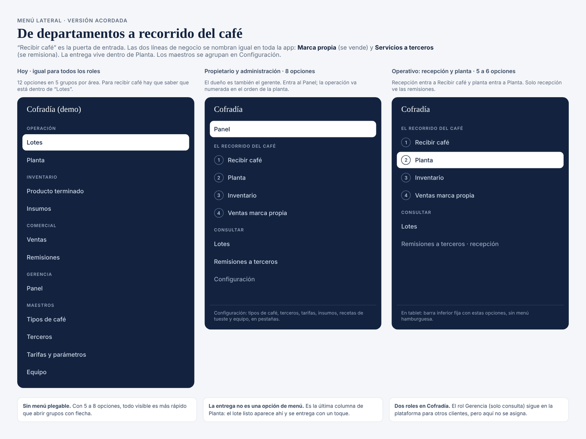
Vista actual: `img/actual/01-menu.png`

---

### A-08 · Recibir café: una sola entrada con tipo de ingreso — Ola 2

**Hoy:** dos formularios, «Nueva compra» (marca propia) y «Nueva recepción» (terceros), a los que se llega con botones dentro de Lotes.

**Debe quedar**
- Una pantalla **«Recibir café»** (opción 1 del menú y botón principal en Planta).
- Primer campo, **«Tipo de ingreso»**, con dos botones grandes:
  - **Marca propia** — «Compra de café para Cofradía · lote MP»: calidad, proveedor (último sugerido), bultos (+/−, 62,5 kg sugerido), peso real, precio por kg (último pagado sugerido, editable), humedad opcional, factura del proveedor opcional.
  - **Servicios a terceros** — «Trilla y/o maquila · lote MQ»: los campos de A-09.
- Resumen lateral: «Se creará MQ-AAAA-NNNN / MP-AAAA-NNNN», hora de llegada, valor (A-10), casilla «Imprimir etiqueta del lote», botón **«Guardar y enviar a planta»**.
- Al guardar, el lote aparece en Planta en la columna de su primer proceso.

**Criterio:** [ ] Desde un solo formulario se crean lotes MP y MQ; los dos formularios anteriores redirigen a este.

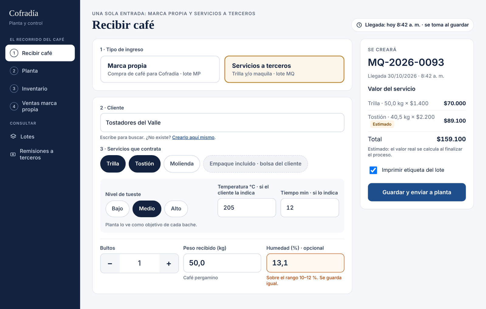
Vista actual: `img/actual/02-recibir-cafe.png`

---

### A-09 · Temperatura y tiempo del cliente; orden de los campos — Ola 2

- Orden en servicios a terceros: **cliente → servicios contratados y tueste → bultos y peso → calidad**.
- Si se contrata tostión, el **nivel de tueste es obligatorio** (define la merma de referencia). Junto a él van **temperatura (°C) y tiempo (min)** indicados por el cliente, opcionales.
- Planta ve ese perfil en la tarjeta del lote y como objetivo en tostión (A-12). La remisión lo imprime como «Pedido: medio · 205 °C · 12 min».
- El rango de humedad viene precargado (10–12 %) en el alta del cliente de café. Los enlaces «Configurar en Tarifas y parámetros» **no se muestran al rol Operativo**.
- Fuera de alcance por ahora: varios perfiles de tueste dentro de un mismo lote.

**Criterio:** [ ] Un lote con perfil «medio · 205 °C · 12 min» lo muestra en la tarjeta de Planta, en tostión y en la remisión.

---

### A-10 · Valor del servicio con los valores estimados marcados — Ola 2

- El recuadro pasa a llamarse **«Valor del servicio»**.
- Regla: el **primer proceso contratado es exacto**, porque entra con el peso recibido × la tarifa vigente. Cada proceso siguiente es **estimado**: su peso de entrada es la salida estimada del anterior, `entrada_anterior × (1 − merma_referencia)`.
- Cada línea estimada lleva la etiqueta «Estimado». La nota «Estimado: el valor real se calcula al finalizar el proceso» aparece **solo si hay al menos una línea estimada** (no aparece con solo trilla, solo tostión o solo molienda).

**Criterio:** [ ] 50,0 kg con trilla y tostión: Trilla 50,0 × $1.400 = $70.000, exacto. Tostión 40,5 × $2.200 = $89.100, «Estimado». Total $159.100, con la nota.

---

### A-11 · Hora de llegada automática — Ola 2

- La hora de llegada es la del registro (`created_at` o un campo dedicado), tomada automáticamente al guardar. El operativo no la edita.
- Norma de trabajo para Cofradía: la recepción se registra en la báscula, al pesar.
- Solo el administrador la corrige, con motivo (A-18).
- Visible en la tarjeta de Planta («llegó 7:15 a. m.»), en el listado de lotes y en la ficha.

**Criterio:** [ ] La hora aparece en las tres vistas y un operativo no puede modificarla.

---

### A-12 · Tostión: aplicar a todos; pesaje individual o agrupado — Ola 2

**Hoy**
- Los baches aparecen en cero hasta pulsar «Sugerir baches», y se listan bultos ya procesados.
- La salida muestra «0,0», que parece un valor digitado.
- La temperatura se digita bache por bache.
- Solo existe el pesaje individual.

**Debe quedar**
- Cabecera con el **pedido del cliente** (nivel · temperatura · tiempo) o la receta de marca propia, la referencia de merma y el botón **«Aplicar a todos los baches»**, que copia temperatura y tiempo a los baches.
- Columnas **«Temp. real °C»** y **«Tiempo real min»** editables por el operario en cada bache. Ahí corrige el valor real cuando difiere del pedido; el campo que difiere se resalta. El pedido del cliente no se modifica desde tostión.
- Una vez registrado el proceso, solo el administrador corrige temperatura o tiempo, con motivo e historial (A-18).
- Baches **sugeridos automáticamente** (capacidad 13,5 kg, repartidos en partes iguales) **solo con los bultos pendientes**. Los campos de salida van vacíos.
- **«Pesaje de salida»: `Individual` | `Agrupado`.** En agrupado, el operario une baches en grupos y digita un solo peso de salida por grupo; el sistema reparte ese peso en proporción a la entrada de cada bache y los marca como `pesaje agrupado`. Se pueden combinar grupos y baches individuales.
- Estado de merma por bache y por grupo según A-03. Total del lote al pie.
- Varios operarios por proceso (ya existe; mantener). El operario que inició sesión va por defecto.

**Criterios de aceptación**
- [ ] Al abrir tostión de 40,5 kg aparecen 3 baches de 13,5 kg sin pulsar nada.
- [ ] «Aplicar a todos» copia 205 °C y 12 min a los 3 baches; el operario cambia el bache 3 a 212 °C y 13 min, y esos campos se resaltan.
- [ ] Tras registrar, un operativo no puede cambiar temperatura ni tiempo; el administrador sí, con motivo.
- [ ] Baches 1 y 2 agrupados con una salida de 22,1 kg más el bache 3 individual en 10,6 kg da un total de 32,7 kg y una merma del lote de 19,3 %.

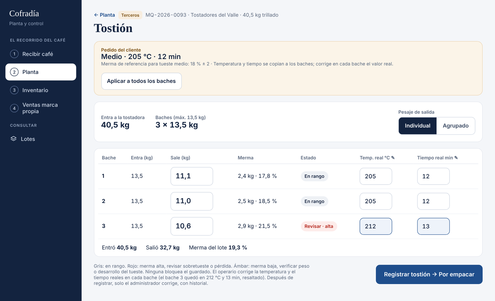
Vista actual: `img/actual/03-tostion.png`

---

### A-13 · Planta: una sola cola y columna «Por entregar» — Ola 2

**Hoy:** la cola se separa en pestañas «Servicios (clientes)» y «Marca propia», y luego por etapa. Al terminar el empaque, el lote sale de Planta.

**Debe quedar**
- **Una sola cola por etapa:** Por trillar · Por tostar · Por moler · Por empacar · **Por entregar**, con la etiqueta de color de la línea (Marca propia / Terceros).
- La tarjeta muestra código, cliente o calidad, kilos y perfil de tueste, y lleva directo al siguiente proceso (ya existe; mantener).
- «Por entregar» (solo terceros) muestra los lotes listos con el botón **«Entregar»** y cuántos días llevan listos.
- Un lote parcial puede aparecer en dos columnas (por ejemplo, bultos por tostar y granel por empacar).
- Fila de avisos arriba: desvío de merma, insumos bajo el mínimo y lotes listos sin recoger por más de N días (parámetro).

**Criterio:** [ ] Un lote MQ con todos sus servicios hechos aparece en «Por entregar» y no desaparece de Planta.

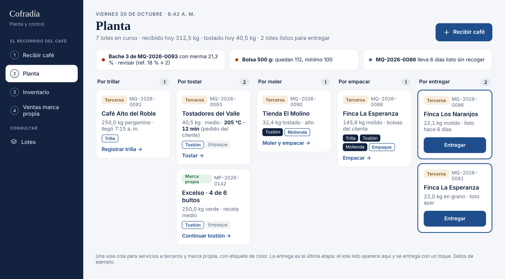
Vista actual: `img/actual/05-planta.png`

---

### A-14 · Entrega desde Planta, varios lotes por remisión, quién recibe — Ola 2

**Hoy:** se entrega desde la ficha del lote con «Generar remisión», una remisión por lote, «Recibe» es opcional y el estado se llama «Vigente».

**Debe quedar**
- La acción se llama **«Entregar»**; la remisión es el comprobante.
- Flujo: **cliente → lotes listos de ese cliente** (checkbox; uno o varios en la misma remisión, usando la relación remisión-lote N:N del modelo) **→ nombre y cédula de quien recibe (obligatorios) → pago (A-20)** → «Entregar e imprimir remisión».
- El resumen lateral muestra el valor real por lote y por servicio, y el total.
- Estados de la remisión: **Entregada** o **Anulada** (se elimina «Vigente»).
- La remisión impresa de 80 mm agrega: hora de llegada, perfil de tueste pedido, cómo se empacó (bolsas del cliente y suelto), quién recibe con cédula, estado de pago y espacio para firma.

**Criterios de aceptación**
- [ ] Dos lotes listos del mismo cliente salen en una sola remisión con un solo total.
- [ ] No se puede entregar sin nombre y cédula de quien recibe.

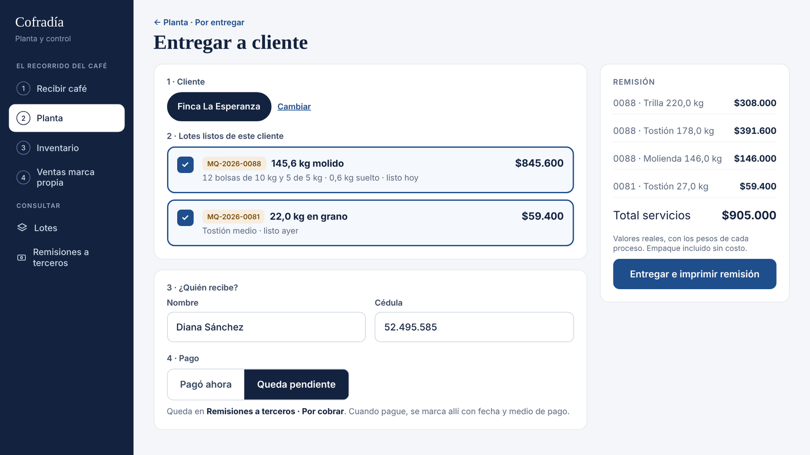
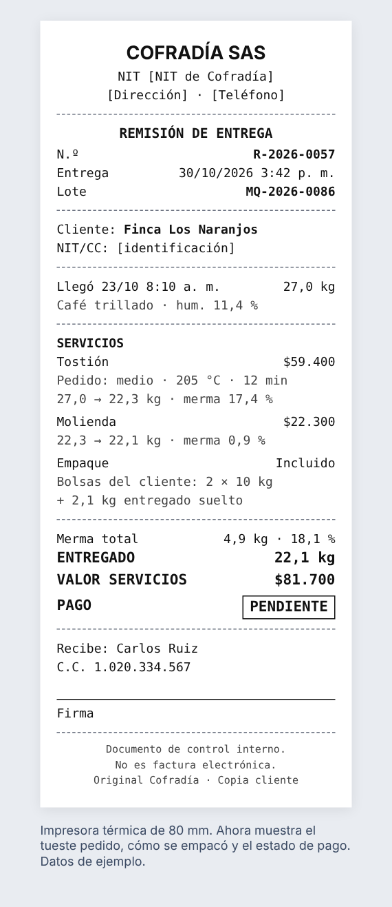
Vista actual: `img/actual/06-entregar.png`, `img/actual/07-remision.png`

---

### A-15 · Inventario en tres pestañas — Ola 2

**Hoy:** «Producto terminado» no indica que es solo marca propia. No hay vista del café de terceros en planta ni del tostado a granel, y no distingue grano de molido.

**Debe quedar:** una sola opción **«Inventario»** con tres pestañas, que nunca se suman entre sí:
1. **Marca propia · para vender:** café verde (bultos y kg), tostado a granel (kg) y empacado (unidades) por calidad × presentación × forma. Acciones: «Registrar salida», «Convertir presentación».
2. **Servicios a terceros:** lotes en planta con su etapa, kilos y días en planta; resalta los listos hace más de N días.
3. **Insumos:** bolsas y etiquetas por presentación (y por calidad, si la etiqueta cambia), con su mínimo y la compra de insumos con precio unitario (A-05).

«Convertir presentación» reemplaza a «Reabrir» (HU-F1-16): por ejemplo, 2 × 2.500 g pasan a 10 × 500 g, descontando y sumando inventario y bolsas, con la traza en el lote de origen.

**Criterio:** [ ] La pestaña de terceros nunca suma kilos con la de marca propia.

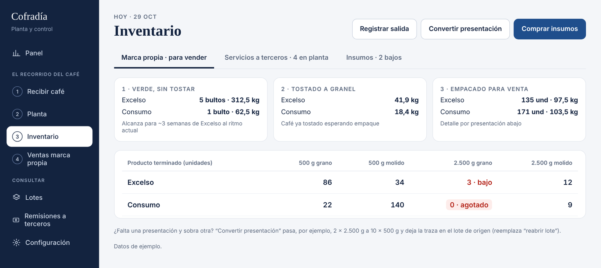
Vista actual: `img/actual/10-inventario.png`

---

### A-16 · Ventas marca propia directo al formulario; factura opcional — Ola 2

**Hoy:** se entra a un listado con tarjetas de resumen y filtros, y desde ahí a «Nueva venta». El estado «Vigente» no se entiende. El campo del número de Aliados siempre está visible.

**Debe quedar**
- Opción del menú: **«Ventas marca propia»**, que entra directo al registro.
- Productos como botones (calidad · presentación · forma) con stock y precio; un toque agrega la línea. «Consumidor final» por defecto.
- Casilla **«Requiere factura electrónica»**: solo al marcarla aparece el campo «N.º de la factura emitida en Aliados».
- Modo **Venta | Cortesía** en la misma pantalla; la cortesía pide destinatario y motivo, ambos obligatorios.
- Si no hay stock, avisa y no bloquea (ya es así).
- Sin tarjetas de resumen (pasan al panel), salvo un aviso «N ventas requieren número de Aliados». Sin «Vigente»: solo se marca «Anulada» cuando aplica. El historial queda en el enlace «Ventas anteriores».
- Fuera de alcance: pedidos para entrega posterior (fase 2). El precio de 2.500 g está por definir con Cofradía.

**Criterio:** [ ] Sin marcar la casilla no aparece el campo de Aliados; al marcarla, aparece.

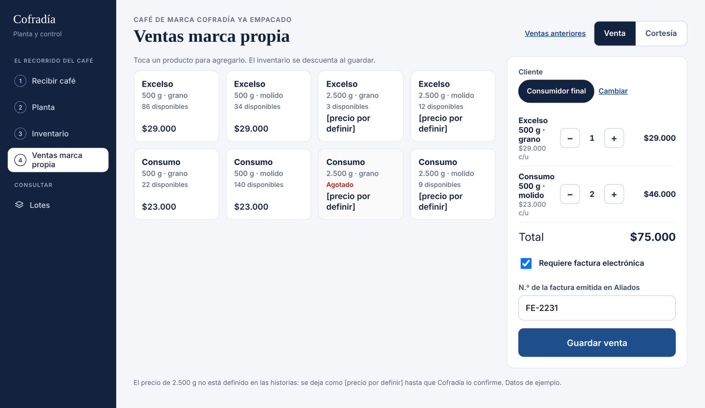
Vista actual: `img/actual/11-ventas.png`

---

### A-17 · Ficha del lote: recorrido y dónde está el café — Ola 2

**Hoy:** ya tiene resumen por etapa, línea de tiempo y empacado, y es una buena base. Pero «325 kg disponibles» suma verde y empacado, y la merma total está mal calculada (A-03).

**Debe quedar**
- Recorrido con el estado de cada etapa, por ejemplo: `Compra → Tostión · 2 de 3 bultos → Empaque · parcial → Agotado`.
- Cifras clave: comprado, tostado, merma sobre lo procesado, a granel y sin tostar.
- Historia del lote con detalle desplegable por evento (baches, temperaturas, operarios, insumos, venta, cortesía, conversión).
- **«Dónde está hoy este café»:** bultos verdes, kg a granel y unidades empacadas por presentación y forma.
- Bloque de costo por libra (A-05) en lotes de marca propia.
- Hora de llegada visible.

---

### A-18 · Edición de lotes solo por el administrador, con historial — Ola 2

- Botón «Editar» visible solo para el administrador.
- Toda edición guarda campo, valor anterior, valor nuevo, usuario, fecha y hora, y un **motivo obligatorio** (se puede extender la auditoría existente).
- Si se corrige un peso, el sistema **recalcula los procesos siguientes** y sus valores, y avisa antes de guardar.
- Un lote **entregado o con ventas** no se edita: primero hay que anular la remisión o la venta.

**Criterio:** [ ] Corregir el peso de entrada de una tostión recalcula su merma, el costo por libra y el valor del servicio, y deja la traza con motivo.

---

### A-19 · Panel: costo por libra, por cobrar y avisos — Ola 2

Se conserva lo que ya tiene (periodo y línea, café recibido, merma ponderada por proceso, ingresos, inventario, gráficos y exportación) y se agrega:
- **Costo de producir una libra** por calidad frente al precio, con el margen (A-05).
- **Por cobrar:** total, número de remisiones y antigüedad de la más vieja (A-20).
- **«Para decidir hoy»:** insumos bajo el mínimo, presentaciones agotadas o bajas, lotes listos sin recoger y clientes con deuda de más de N días.
- **Proveedores de marca propia:** precio por kg, humedad, merma de tostión y costo por kg tostado.
- **Merma de tostión por día** con la banda de referencia (A-03); los días fuera de rango se marcan.
- Renombrar «Trilla y maquila» como «Servicios a terceros» y «Producto terminado» como «Marca propia».

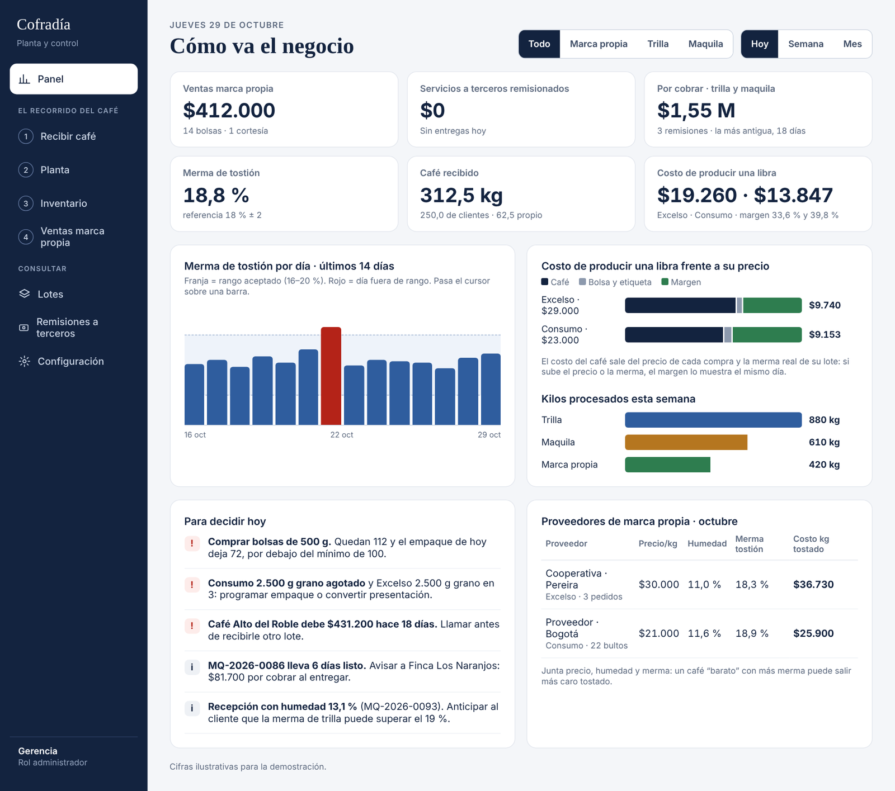
Vista actual: `img/actual/12-panel.png`

---

### A-20 · Estado de pago y «Remisiones a terceros · Por cobrar» — Ola 3 (cambio de alcance)

**Contexto:** muy pocas trillas y maquilas se facturan en Aliados, así que el control de lo que deben los clientes debe quedar en la app.

**Debe quedar**
- Al entregar (A-14): **«Pagó ahora»**, con el medio (efectivo o transferencia), o **«Queda pendiente»**.
- El módulo «Remisiones» pasa a llamarse **«Remisiones a terceros»** y tiene dos pestañas:
  - **Por cobrar:** total por cobrar, número de remisiones pendientes y antigüedad de la más vieja. Lista con remisión, cliente, fecha de entrega, días y valor, y el botón **«Marcar pagada»** (fecha, por defecto hoy, y medio). Las de más de 15 días (parámetro) se resaltan.
  - **Todas las remisiones:** el listado actual, con un filtro de estado de pago.
- Permisos: el administrador y el operativo marcan como pagada; solo el administrador anula.
- **Fuera de alcance:** abonos parciales, saldos por cliente y estados de cuenta (fase de cartera).

**Criterios de aceptación**
- [ ] Una remisión entregada como «Queda pendiente» aparece en «Por cobrar» y suma al total.
- [ ] «Marcar pagada» la saca de «Por cobrar» y guarda la fecha, el medio y el usuario.

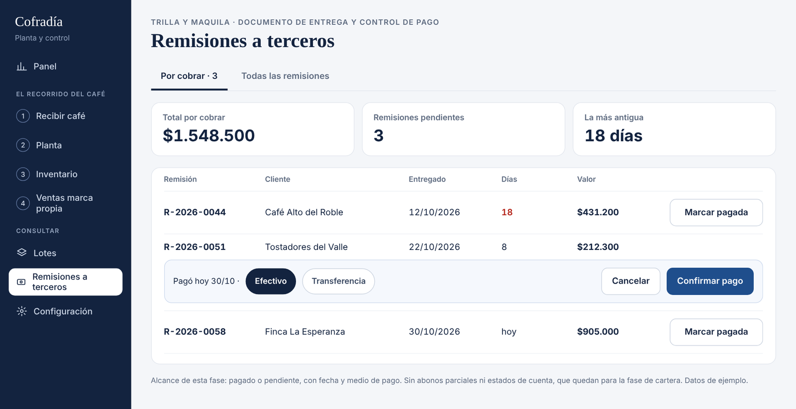
Vista actual: `img/actual/08-remisiones.png`

---

## 4. Cambios de datos probables (propuesta, validar contra el esquema)

No revisamos el esquema de Supabase; esta lista resume lo que los ajustes parecen requerir. Tómala como punto de partida.

| Ajuste | Cambio sugerido |
| --- | --- |
| A-01, A-02 | Tabla `empaque_linea` (proceso_id, peso_bolsa_kg, unidades, forma `grano`/`molido`, presentacion_id nullable, bolsa_cliente bool). En el proceso de empaque: `diferencia_kg` y `diferencia_destino` (`suelto`, `granel`, `muestra`, `perdida`). Sin registro de merma para empaque. Inventario de tostado a granel por lote. |
| A-02, A-15 | Producto terminado por calidad × presentación × forma. |
| A-03 | Parámetro `merma_referencia` por (proceso, nivel_tueste) con vigencia; `tolerancia_pp = 2`. |
| A-05 | `precio_unitario` en la compra de insumos; cálculo de costo por libra por lote (vista o función). |
| A-09 | En el lote o la recepción: `perfil_temp_c` y `perfil_tiempo_min` (nullable). |
| A-11 | Usar la marca de tiempo de creación como hora de llegada; corrección auditada. |
| A-12 | En el bache: `grupo_pesaje` (nullable), `tiempo_min` si no existe. |
| A-14 | En la remisión: `recibe_nombre` y `recibe_documento` (obligatorios); estados `entregada`/`anulada`; relación remisión-lote N:N. |
| A-16 | En la venta: `requiere_factura` bool; número de Aliados nullable. |
| A-18 | Auditoría con `motivo` obligatorio en ediciones. |
| A-20 | En la remisión: `estado_pago` (`pagada`/`pendiente`), `pago_fecha`, `pago_medio` (`efectivo`/`transferencia`), `pago_registrado_por`. |
| A-07 | Pantalla de inicio por usuario. |

---

## 5. Reglas de referencia

- **Tarifas vigentes:** trilla $1.400/kg, tostión $2.200/kg, molienda $1.000/kg (sobre el peso que entra al proceso). Empaque sin costo.
- **Capacidad de la tostadora:** 13,5 kg por bache.
- **Bulto:** 62,5 kg sugerido.
- **Precios de venta (500 g):** Consumo $23.000, Excelso $29.000. Los de 2.500 g están por definir.
- **Numeración:** lotes `MP-AAAA-NNNN` / `MQ-AAAA-NNNN`; remisiones con numeración propia.

---

## 6. Pruebas de punta a punta

1. **Terceros a crédito.** Recibir 220,0 kg de pergamino con trilla, tostión (medio, 205 °C, 12 min) y molienda → trillar → tostar con pesaje agrupado en dos baches → moler → empacar 12 × 10 kg + 5 × 5 kg, con la diferencia «se entrega suelto» → «Entregar ahora» junto con otro lote listo del mismo cliente → «Queda pendiente» → aparece en «Por cobrar» → «Marcar pagada» por transferencia.
2. **Perfil distinto por bache.** Lote de terceros de 40,5 kg: «Aplicar a todos» (205 °C), bache 3 a 212 °C, merma alta en el bache 3 → aviso rojo sin bloquear.
3. **Marca propia.** Compra de 3 bultos de Excelso a $30.000/kg → tostar 2 bultos → empacar 40 × 500 g en grano y 8 × 2.500 g molido, con el sobrante a granel → el inventario por presentación y forma cuadra → la ficha muestra dónde está el café y el costo por libra → venta de 2 unidades con factura electrónica marcada.
4. **Corrección.** El administrador corrige el peso de entrada de una tostión, con motivo → se recalculan merma, valor y costo por libra, y queda la traza; un operativo no ve el botón «Editar».

---

## 7. Pendientes de Cofradía (no bloquean el desarrollo)

- Mermas de referencia por proceso y nivel de tueste (mientras tanto: trilla 19 %, tostión 18 % para todos los niveles).
- Precio de venta de la presentación de 2.500 g.
- Costo unitario actual de bolsas y etiquetas.
