# Cofradía · Ajustes a la Fase 1 · v2 — cambios de las pruebas funcionales

**Cliente:** Cofradía SAS (vertical de café) · **Preparado por:** Blue · **Fecha:** 4 de noviembre de 2026
**Origen:** primera sesión de pruebas funcionales con Cofradía. Todas las decisiones de este documento están **acordadas por escrito con Cofradía**.

> **Punto de partida:** los ajustes de la v1 (`AJUSTES_COFRADIA_FASE1.md`, 30 de octubre) **ya están implementados en `develop`**, excepto el estado de pago y Por cobrar (A-20), que no se construyó y no se construye en esta fase.
> **Este documento solo describe cambios sobre lo que ya existe.** No reimplementes nada de la v1: la v1 queda en la carpeta únicamente como referencia de cómo se pensó cada pantalla.

---

## 0. Cómo usar este documento

1. Deja la carpeta completa en `docs/cofradia-ajustes-fase1/` del repositorio (v1, v2 e imágenes).
2. Implementa **un ajuste a la vez** por su ID: «implementa B-05 según `docs/cofradia-ajustes-fase1/AJUSTES_COFRADIA_FASE1_v2.md`, partiendo del código actual».
3. **Antes de cada ajuste B, revisa en el código cómo quedó implementado el ajuste A relacionado** (sección 1). Varios ajustes B no agregan: **modifican o retiran** algo que ya existe. Retira el código y los componentes que queden sin uso; no los dejes ocultos.
4. Si algo de la v1 no aparece en el código o quedó distinto a lo descrito, **pregunta antes de construirlo**: puede haberse decidido otra cosa.
5. Conserva el sistema visual de la app. Las imágenes de `img/propuesta-v2/` indican **contenido, orden y comportamiento**; no su estilo. Las cifras son de ejemplo. Las imágenes de `img/propuesta/` (v1) ya no son referencia.
6. Los textos que ve el usuario siguen la **guía de microcopy** de la sección 3. Aplica a todo texto nuevo o modificado.
7. Migraciones reversibles y sin romper datos de otros clientes de la plataforma. Si se retira un campo, primero ocúltalo y déjalo nullable; bórralo solo cuando se confirme.

---

## 1. Qué pasa con lo que ya está construido (v1)

| Ajuste v1 (implementado) | Qué hacer ahora | Ajuste v2 |
| --- | --- | --- |
| A-01 Empaque: líneas de bolsas y diferencia clasificada (suelto, granel, muestra, pérdida) | **Reemplazar.** Se retira la clasificación de la diferencia. El peso total en báscula calcula la merma de tostión; el sobrante va a «Tostado sin empacar» (marca propia) o «a granel» (terceros). En marca propia, las líneas se reemplazan por una **tabla fija**. | B-08, B-09 |
| A-02 Bolsas de terceros de peso libre | **Mantener** y simplificar: peso rápido 10 kg / 5 kg / Otro, cantidad con campo numérico. | B-08 |
| A-03 Alerta de merma de dos lados | **Mantener la regla** (±2 pp, gris/rojo/ámbar). **Retirar la merma por bache**; ahora se evalúa por tanda y acumulada del lote, y en trilla. | B-04, B-08 |
| A-04 Pesos con 1 decimal | **Mantener.** Además, **retirar los bultos** de toda la app. | B-01 |
| A-05 Costo de producir una libra | **Modificar:** precios reales de insumos y costo por presentación (500 g y 2.500 g). | B-13 |
| A-06 Nombre del cliente en pestaña y login | Sin cambios. | — |
| A-07 Menú por recorrido y por rol | Sin cambios. | — |
| A-08 a A-11 Recibir café | **Modificar:** solo kg; marca propia sin panel de perfil (lo toma del tipo de café); maquila con uno o varios perfiles por kilos; cantidad a moler. | B-01, B-02, B-03, B-18 |
| A-12 Tostión: aplicar a todos, pesaje individual o agrupado | **Retirar** el peso de salida por bache y el pesaje individual/agrupado (`grupo_pesaje`). **Reemplazar** «Aplicar a todos» por selección múltiple y «Aplicar a los seleccionados». Agregar la decisión de molienda al cerrar. | B-05, B-06 |
| A-13 Planta: una sola cola | **Mantener la cola. Retirar la fila de avisos.** Las tarjetas de trilla y molienda abren sus nuevas pantallas. | B-19, B-04, B-07 |
| A-14 Entrega desde Planta | **Mantener** (cliente → lotes → quién recibe → fecha y observaciones, sin pago). **Corregir la vista de impresión** de la remisión. | B-17 |
| A-15 Inventario en tres pestañas | **Modificar** la pestaña Marca propia: tres bloques, libras y cobertura en días. Agregar «Ajustar inventario» y carga inicial. | B-10, B-15 |
| A-16 Ventas marca propia | **Modificar:** se cambia «avisar» por **bloquear** la venta sin stock. | B-11 |
| A-17 Ficha del lote | **Modificar:** pasos pendientes con enlace al proceso. | B-12 |
| A-18 Edición de lotes por el administrador | **Corregir:** falló en la prueba (no guardó). | B-16 |
| A-19 Panel | **Reemplazar** por el panel orientado al dueño. | B-14 |
| A-20 Estado de pago y Por cobrar | **No construido y fuera de esta fase.** No implementar. «Remisiones a terceros» queda como listado (ver, reimprimir, anular). Imagen: `img/propuesta-v2/13-remisiones-a-terceros.png`. | — |

**Qué se retira del código actual (resumen):** captura de bultos y peso por bulto · peso de salida por bache y pesaje agrupado · clasificación de la diferencia de empaque · merma de molienda y de empaque · fila de avisos de Planta · aviso de «sin stock» que permitía vender · «merma total» en la remisión · la palabra «receta» en la interfaz.

---

## 2. Principios transversales (actualizados)

| Tema | Regla |
| --- | --- |
| Unidad de peso | **Solo kilogramos**, con 1 decimal en pantalla. Se eliminan los bultos de toda la app (recepción, planta, inventario, ficha). |
| Unidad de venta | **Libra = 500 g.** El panel y el inventario de producto terminado hablan en libras. Una bolsa de 2.500 g = 5 lb. |
| Merma | Solo existe merma en **trilla** (peso final de trilla) y en **tostión** (calculada con el peso total en báscula al empacar). **Molienda y empaque no tienen merma.** |
| Sobrante de empaque | Marca propia: pasa a **«Tostado sin empacar»**. Nunca vuelve a café verde. Terceros: se entrega a granel al cliente. |
| Estimados | Toda cifra calculada antes de tiempo (molienda, tostado esperado, valor del servicio) lleva la etiqueta **«Estimado»**. |
| Inventario | No se vende lo que no hay (B-11). Las correcciones se hacen con **Ajustar inventario**, con motivo y auditoría (B-15). |
| Vocabulario | Marca propia / Servicios a terceros (v1). Inventario de marca propia: **Café verde por tostar · Tostado sin empacar · Producto terminado**. |
| Glosario de tueste | **Tostión** = el proceso. **Tipo de café** = Excelso o Consumo (solo marca propia). **Nivel de tueste** = Alto, Medio o Bajo (marca propia y maquila). **Perfil de tueste** = nivel de tueste + temperatura + tiempo. **Perfil 1, Perfil 2** = cada perfil con sus kilos cuando un lote de maquila trae varios. **No se usa la palabra «receta»** en ninguna pantalla ni documento impreso (B-20). |
| Alcance | Esta fase **no** controla pagos ni cuentas por cobrar de terceros. |

---

## 3. Guía de microcopy (aplica a toda la app)

Objetivo acordado con Cofradía: textos **corporativos, frescos, ejecutivos y claros**. Que la herramienta se lea como software profesional, no como una app informal.

| Regla | Sí | No |
| --- | --- | --- |
| Botones en infinitivo, con el resultado cuando ayuda | «Registrar trilla → Por tostar» · «Guardar venta» · «Aplicar a los seleccionados» | «¡Listo, guardemos!» · «Dale» |
| Ayudas e indicaciones en forma impersonal | «Seleccionar un producto para agregarlo» · «Humedad y densidad se registran al finalizar la trilla» | «Toca aquí para…» · «Tú puedes…» |
| Confirmaciones: hecho + siguiente paso | «Empaque registrado. Lote MQ-2026-0088 listo para entrega.» | «¡Súper! Todo salió bien 🎉» |
| Errores: qué pasó + cómo resolverlo | «Las bolsas suman más que el peso en báscula. Revisar cantidades.» | «Ups, algo salió mal» |
| Alertas: dato primero, sin adjetivos | «Consumo 2.500 g agotado. Programar empaque.» | «¡Atención! Te quedaste sin café» |
| Sin exclamaciones, sin emoji, sin diminutivos | «Lote listo» | «¡Lotecito listo! ☕» |
| Cifras con unidad y formato colombiano | «202,0 kg» · «$28.500/kg» · «18,1 %» | «202 kgs» · «28500» |
| Estados con una o dos palabras | «En rango» · «Revisar · alta» · «Verificar · baja» · «Agotado» | Frases largas en una etiqueta |

Revisar con esta guía los textos existentes de las pantallas tocadas en cada ajuste.

---

## 4. Backlog v2

**Ola 1** corrige datos o bloquea la operación diaria; cerrarla antes de la segunda sesión de pruebas. **Ola 2** flujo y uso. **Ola 3** alcance nuevo (se estima aparte).

| ID | Ajuste | Tipo | Ola | Pantalla |
| --- | --- | --- | --- | --- |
| B-01 | Solo kilogramos; eliminar bultos | Corrección | 1 | Toda la app |
| B-08 | Empaque: líneas grano/molido, peso en báscula y merma de tostión | Corrección | 1 | Planta · empaque |
| B-09 | Sobrante a «Tostado sin empacar» (corrige el bloque vacío) | Corrección | 1 | Empaque, inventario |
| B-11 | Bloquear venta sin stock | Corrección | 1 | Ventas marca propia |
| B-16 | Edición de lotes por el administrador (falló en la prueba) | Corrección (A-18) | 1 | Ficha del lote |
| B-15 | Ajustar inventario y carga inicial | Corrección | 1 | Inventario |
| B-05 | Tostión sin peso de salida; selección múltiple y aplicar en bloque | Ajuste | 1 | Planta · tostión |
| B-02 | Recibir café: perfil oculto en marca propia, perfiles por kilos en maquila | Ajuste | 2 | Recibir café, Configuración |
| B-03 | Recibir café: cantidad a moler | Ajuste | 2 | Recibir café |
| B-04 | Trilla: peso final, humedad y densidad al finalizar | Ajuste | 2 | Planta · trilla |
| B-06 | Decisión de molienda al cerrar la tostión | Ajuste | 2 | Planta · tostión |
| B-07 | Molienda como confirmación | Ajuste | 2 | Planta · molienda |
| B-10 | Inventario marca propia en tres bloques, con cobertura | Ajuste | 2 | Inventario |
| B-12 | Ficha del lote: pasos pendientes con enlace | Ajuste | 2 | Ficha del lote |
| B-13 | Insumos con precio real; costo por libra por presentación | Ajuste | 2 | Insumos, ficha, panel |
| B-17 | Remisión impresa: regreso visible, sin merma total | Corrección | 1 | Vista de impresión |
| B-19 | Planta sin fila de avisos | Ajuste | 1 | Planta |
| B-20 | Glosario de tueste unificado | Ajuste | 1 | Recibir café, Tostión, Configuración, ficha, remisión |
| B-14 | Panel de gerencia orientado al dueño | Ajuste | 2 | Panel |
| B-18 | Perfiles de tueste por tipo de café en Configuración | Ajuste | 2 | Configuración |

Orden sugerido: B-17 (lo ve el cliente final) → B-01 → B-19 → B-20 → B-18 → B-02 → B-03 → B-04 → B-05 → B-06 → B-07 → B-08 → B-09 → B-10 → B-15 → B-11 → B-12 → B-13 → B-16 → B-14. El panel va al final porque consume los datos de todos los anteriores.

---

## 5. Especificación por ajuste

### B-01 · Solo kilogramos; eliminar bultos — Ola 1

**Hoy:** recepción, planta, tostión y ficha hablan de bultos («4 de 6 bultos»). Cofradía no opera por bultos.

**Debe quedar**
- La recepción captura **«Peso recibido (kg)»**, un solo campo. Sin número de bultos ni peso por bulto.
- Todo saldo se expresa en kg: «202,0 kg por tostar · de 320,0 kg».
- Se retira el parámetro «bulto sugerido 62,5 kg».

**Criterios**
- [ ] Ninguna pantalla muestra la palabra «bulto».
- [ ] Un lote de 320,0 kg con 118,0 kg tostados muestra «202,0 kg por tostar».

---

### B-18 · Perfiles de tueste por tipo de café — Ola 2

**Debe quedar** en Configuración › **Perfiles de tueste por tipo de café**, editable por el administrador, con fecha de vigencia:

| Tipo de café | Nivel de tueste | Temperatura | Tiempo |
| --- | --- | --- | --- |
| Excelso (marca propia) | Medio | 216 °C | 17 min |
| Consumo (marca propia) | Medio | 222 °C | 17 min |
| Maquila (predeterminado de terceros) | Medio | 222 °C | 17 min |

**Criterio:** [ ] Cambiar el perfil de tueste de Excelso afecta solo los lotes recibidos después.

---

### B-02 · Recibir café: perfil oculto en marca propia y perfiles por kilos — Ola 2

**Marca propia**
- No se muestra el panel de perfil. El lote toma el **perfil de tueste de su tipo de café** (B-18) y la tostión lo muestra en cabecera.
- Campos: tipo de café, proveedor, factura, peso recibido (kg), precio por kg, humedad y densidad (opcionales).

**Servicios a terceros**
- Cliente, peso recibido (kg), servicios contratados (trilla, tostión, molienda; empaque incluido con bolsa del cliente).
- Ayuda bajo servicios: «Humedad y densidad se registran al finalizar la trilla.»
- Panel **«Perfil de tueste»** con selector **`Un perfil para todo el lote` | `Varios perfiles`**:
  - Un perfil: nivel de tueste, temperatura y tiempo, precargados con el perfil de maquila (Medio · 222 °C · 17 min).
  - Varios perfiles: filas «Perfil N» con nivel de tueste, temperatura, tiempo y **kilos**. La suma de kilos debe igualar lo que entra a tostión (estimado tras trilla, si hay trilla). Se permite agregar y quitar perfiles.
- Esto **revierte** la decisión del 30 de octubre de un solo perfil por lote. Es cambio de alcance acordado.

**Criterios**
- [ ] Marca propia Excelso no muestra el panel de perfil y su tostión abre con 216 °C · 17 min.
- [ ] Terceros abre con un perfil de 222 °C · 17 min sin digitar nada.
- [ ] Con «Varios perfiles», 27,0 kg + 13,5 kg sobre 40,5 kg guarda; 27,0 + 10,0 muestra «Los kilos por perfil deben sumar 40,5 kg».

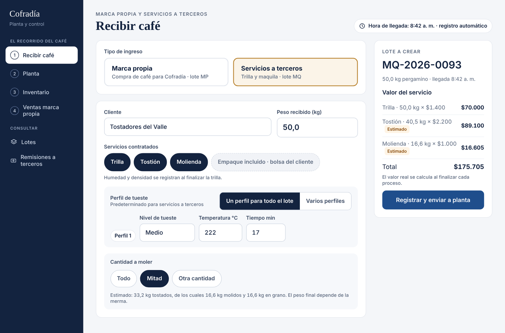

---

### B-03 · Recibir café: cantidad a moler — Ola 2

**Debe quedar** (solo si se contrata molienda): **«Cantidad a moler»** con `Todo` | `Mitad` | `Otra cantidad (kg)`, y un estimado: «Estimado: 33,2 kg tostados, de los cuales 16,6 kg molidos y 16,6 kg en grano. El peso final depende de la merma.»

- El estimado usa la merma de referencia de trilla y tostión.
- La cantidad se puede modificar al cerrar la tostión (B-06).
- El **valor del servicio** de molienda en el resumen lleva «Estimado».

**Criterio:** [ ] Con 50,0 kg pergamino, trilla y tostión, «Mitad» muestra 16,6 kg a moler.

---

### B-04 · Trilla: peso final, humedad y densidad — Ola 2

**Debe quedar** una pantalla de trilla (tarjeta «Por trillar» en Planta) con:
- Entrada: kg de pergamino (del lote).
- **Peso final (kg)**, **Humedad (%)**, **Densidad (g/L)**, al finalizar el proceso.
- Merma de trilla con la banda de A-03 (referencia 19 % ± 2).
- Botón **«Registrar trilla → Por tostar»**.

**Criterios**
- [ ] 250,0 → 202,5 kg muestra merma 19,0 % «En rango».
- [ ] Humedad y densidad quedan en el lote y salen en la remisión.

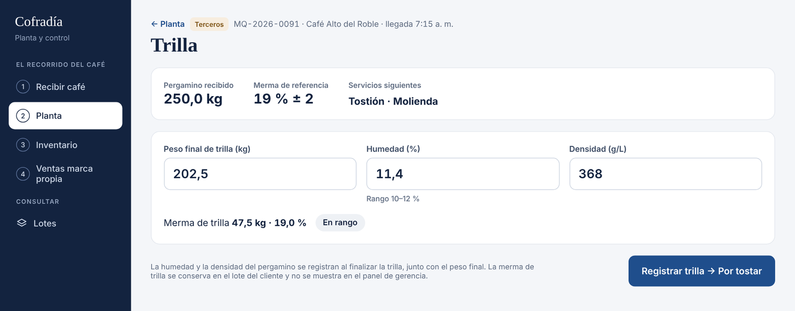

---

### B-05 · Tostión sin peso de salida; selección múltiple — Ola 1

**Hoy:** se pide peso de salida por bache, y la planta no pesa por bache.

**Debe quedar**
- Cabecera: pendiente por tostar (kg), **kilos a tostar ahora** (editable; permite tandas parciales), baches (máx. 13,5 kg, repartidos en partes iguales) y el perfil de tueste. Marca propia: «Tipo de café · perfil de tueste: Excelso · Medio · 216 °C · 17 min». Maquila: los perfiles de la recepción.
- Tabla de baches: **Bache · Entra (kg) · Nivel de tueste · Temperatura · Tiempo**. La columna **Perfil** (Perfil 1, Perfil 2) aparece **solo en maquila**. Nunca «Receta Excelso». **Sin columna de salida.**
- En maquila con varios perfiles, los baches se generan por perfil según sus kilos.
- Casilla por bache y casilla general. Al seleccionar uno o más, aparece una barra: **«N baches seleccionados · Nivel de tueste · Temperatura · Tiempo · Aplicar a los seleccionados»**. Solo cambia los campos digitados; los campos que difieren del perfil se resaltan.
- Ayuda al pie: «El peso final se registra en empaque; allí se calcula la merma de tostión.»
- Botón: «Registrar tostión → Por moler» (o «→ Por empacar» si no hay molienda).

**Criterios**
- [ ] 54,0 kg de Excelso generan 4 baches de 13,5 kg con 216 °C · 17 min.
- [ ] Seleccionar baches 3 y 4 y aplicar Alto · 220 °C cambia solo esos dos; el tiempo queda en 17 min.
- [ ] La tostión se registra sin ningún peso de salida.

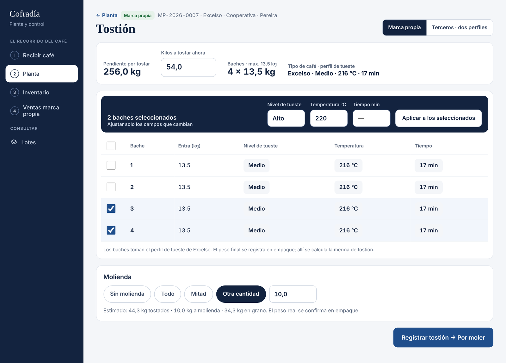

---

### B-06 · Decisión de molienda al cerrar la tostión — Ola 2

**Debe quedar** en la tostión una tarjeta **«Molienda»** con `Sin molienda` | `Todo` | `Mitad` | `Otra cantidad (kg)`:
- Terceros: precargado con lo pedido en la recepción (B-03).
- Marca propia: el operario elige la cantidad. Sin sugerencias automáticas en esta fase.
- Texto: «Estimado: 44,3 kg tostados · 10,0 kg a molienda · 34,3 kg en grano. El peso real se confirma en empaque.»

**Criterio:** [ ] «Sin molienda» envía el lote directo a «Por empacar».

---

### B-07 · Molienda como confirmación — Ola 2

**Debe quedar:** pantalla corta **«Confirmar molienda»** con tostado estimado, a molienda y en grano, y dos botones: «Modificar cantidad» y **«Molienda realizada → Por empacar»**. No pide pesos. Texto: «La molienda no genera merma.»

- La tarifa de molienda de terceros se liquida con los **kg molidos registrados en empaque** (B-08). Ver pendiente 1 de la sección 8.

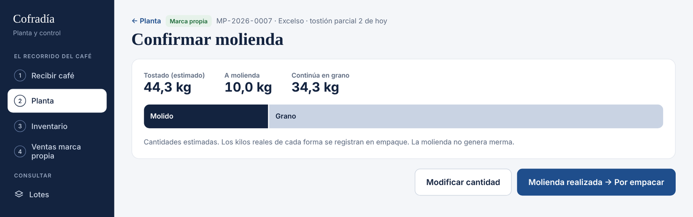

---

### B-08 · Empaque: grano y molido, báscula y merma de tostión — Ola 1

**Hoy:** empaque pide peso de salida y calcula merma propia; una presentación no se puede registrar en grano y molido a la vez.

**Debe quedar**
- Cabecera: **entró a tostión en esta tanda (kg)**, molienda solicitada (kg), tostado estimado (kg).
- **Marca propia: tabla fija** con una fila por presentación activa (500 g, 2.500 g; salen de Configuración) y dos columnas de cantidad: **Grano · bolsas** y **Molido · bolsas**, más los kilos por fila y el total por columna. Todas las casillas visibles desde el inicio, en cero; el operario solo digita lo empacado. Sin «Agregar línea», sin selectores, sin combinaciones duplicadas.
  - Campos numéricos (teclado numérico en tablet, tabulador entre casillas). Sin botones «+/−» para cantidades.
  - Una presentación nueva en Configuración agrega una fila; no requiere cambios de código.
- **Terceros: líneas de bolsas del cliente**, porque el peso es libre (A-02) y no descuenta insumos: peso por bolsa con selección rápida `10 kg` | `5 kg` | `Otro (kg)`, forma `Grano` | `Molido`, número de bolsas (campo numérico) y kilos. «+ Agregar bolsas».
- Cierre del empaque:
  - **En bolsas (kg)**: suma de las líneas.
  - **Sobrante (kg)**: marca propia «queda tostado sin empacar»; terceros «se entrega a granel».
  - **Peso total en báscula (kg)**: incluye el sobrante.
  - **Merma de tostión · esta tanda** = (entró a tostión − peso total en báscula) / entró a tostión, con la banda de A-03 (18 % ± 2).
  - **Acumulado del lote**: Σ entrada a tostión → Σ báscula · merma acumulada.
  - Validación: «Molido empacado: 10,0 kg · solicitado 10,0 kg» (aviso, no bloquea si difiere).
- La merma se **asigna al proceso de tostión** del lote. Molienda y empaque no registran merma.
- Insumos (marca propia): bolsas y etiquetas por presentación y calidad, con su costo (B-13).
- Al terminar: «Empaque registrado.» Terceros: «Lote MQ-… listo para entrega» con «Entregar ahora» / «Después».

**Criterios**
- [ ] La tabla de marca propia muestra las cuatro casillas (500 g y 2.500 g, grano y molido) sin pulsar nada.
- [ ] MP-2026-0007 tanda 2: entran 54,0 kg; 500 g: 48 grano y 20 molido; 2.500 g: 4 grano y 0 molido = 44,0 kg; sobrante 0,3; báscula 44,3 → merma 18,0 % «En rango».
- [ ] Acumulado con la tanda 1 (64,0 → 52,4): 118,0 → 96,7 kg · 18,1 %.
- [ ] Bolsas que suman más que la báscula: «Las bolsas suman más que el peso en báscula. Revisar cantidades.»
- [ ] El panel no muestra merma de molienda ni de empaque.

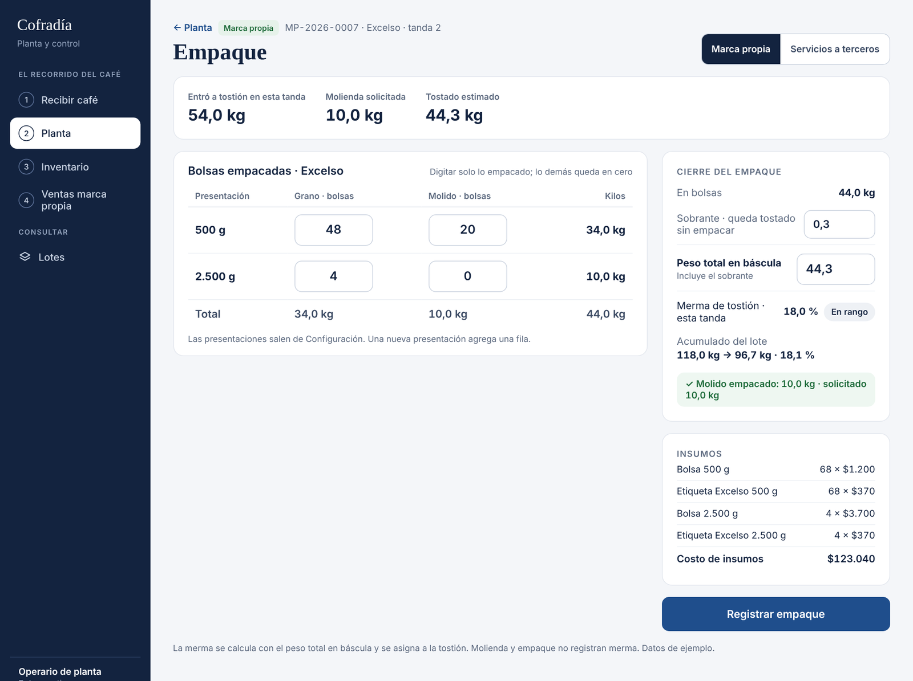

---

### B-09 · Sobrante a «Tostado sin empacar» — Ola 1

**Hoy:** el bloque de tostado a granel aparece vacío aunque hubo sobrante.

**Debe quedar**
- El sobrante de marca propia suma a **Tostado sin empacar** por lote, calidad y forma (grano/molido).
- En el siguiente empaque de la misma calidad y forma, la app ofrece incluirlo: «Hay 0,7 kg de Excelso en grano sin empacar. Incluir en este empaque.»
- **Nunca** vuelve a café verde.

**Criterios**
- [ ] Tras B-08, Inventario › Marca propia › Tostado sin empacar muestra Excelso · grano 0,7 kg.
- [ ] Incluirlo en un empaque lo descuenta del bloque y no altera la merma de la tanda.

---

### B-10 · Inventario de marca propia en tres bloques — Ola 2

**Debe quedar** en la pestaña Marca propia:
1. **Café verde por tostar** (kg por calidad), con «alcanza para N días de venta».
2. **Tostado sin empacar** (kg por calidad × forma).
3. **Producto terminado · listo para vender**: libras disponibles, cobertura en días y valor a costo.

Tabla de producto terminado: **calidad + presentación · grano (und) · molido (und) · libras · alcanza para**. Cero en rojo «0 · agotado»; cobertura menor a 10 días en rojo.

- **Cobertura (días)** = libras disponibles / promedio diario de libras vendidas de los últimos 30 días.
- Acciones: «Ajustar inventario» (B-15), «Convertir presentación» (v1), «Comprar insumos».

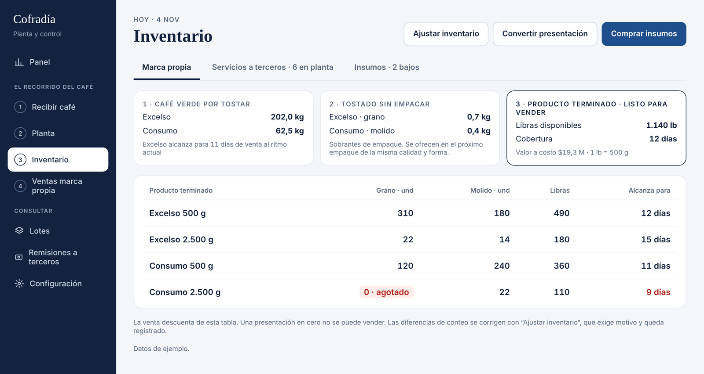

---

### B-11 · Bloquear venta sin stock — Ola 1

**Hoy:** se vendió Consumo 2.500 g sin stock y el inventario quedó en −3. Esto **revierte** la regla v1 «avisar, no bloquear» solo para ventas; es decisión acordada con Cofradía.

**Debe quedar**
- Producto con stock 0: tarjeta deshabilitada, «Agotado».
- El «+» se deshabilita al llegar al stock: «Máximo disponible: 14».
- El servidor valida también: una venta que deje stock negativo se rechaza con «Stock insuficiente para Excelso 2.500 g molido. Disponible: 14.»
- Aplica igual a cortesías.

**Criterios**
- [ ] No se puede agregar Consumo 2.500 g grano con stock 0.
- [ ] Una petición directa a la API con cantidad mayor al stock se rechaza.

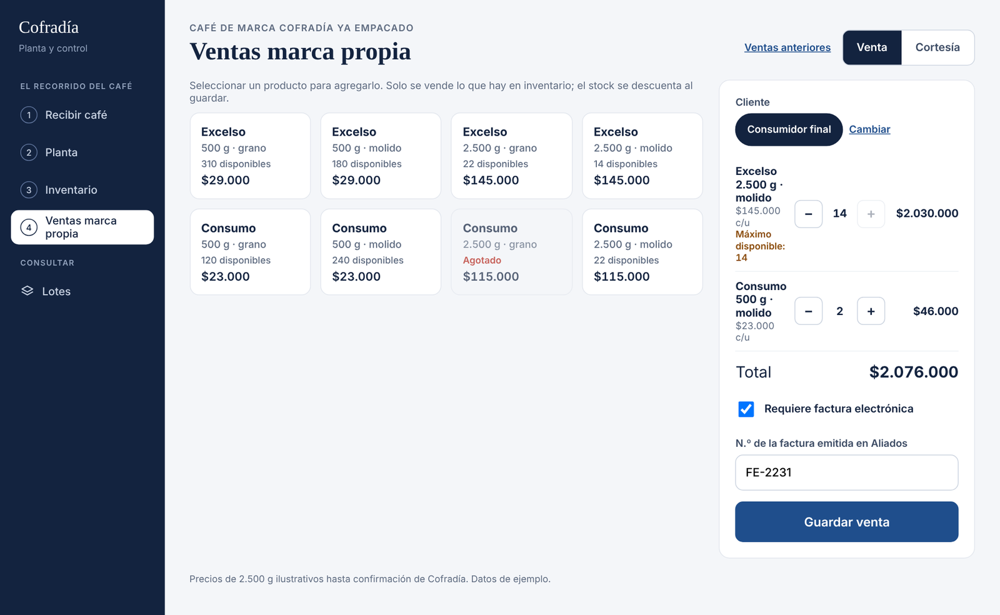

---

### B-15 · Ajustar inventario y carga inicial — Ola 1

**Hoy:** el stock negativo de la prueba no tiene cómo corregirse, y cargar el inventario que Cofradía ya tiene obligaría a registrarlo como compra.

**Debe quedar**
- **Ajustar inventario** (solo administrador): producto, cantidad nueva o diferencia, **motivo obligatorio** (conteo físico, daño, muestra, corrección). Queda en auditoría y en la ficha del producto.
- **Carga inicial** (solo administrador, una vez por producto, desde Configuración): producto terminado, tostado sin empacar y café verde, con **costo unitario estimado** para valorar el inventario. No genera compra ni factura.
- Corregir el −3 de Consumo 2.500 g con un ajuste antes de la segunda prueba.

**Criterio:** [ ] Ningún producto queda negativo; cada ajuste muestra quién, cuándo y por qué.

---

### B-12 · Ficha del lote: pasos pendientes con enlace — Ola 2

**Debe quedar**
- Recorrido en fichas: Compra · Trilla · Tostión · Molienda · Empaque · Agotado/Entregado. Las **pendientes o parciales son enlaces** al proceso: «Tostión → 118,0 de 320,0 kg · continuar».
- KPIs: comprado, procesado (entró a tostión), merma de tostión acumulada, tostado sin empacar, por tostar.
- Historia del lote por evento (tanda de tostión, empaque con merma de la tanda, molienda confirmada).
- «Dónde está hoy este café» en kg y unidades por presentación y forma, más lo vendido.

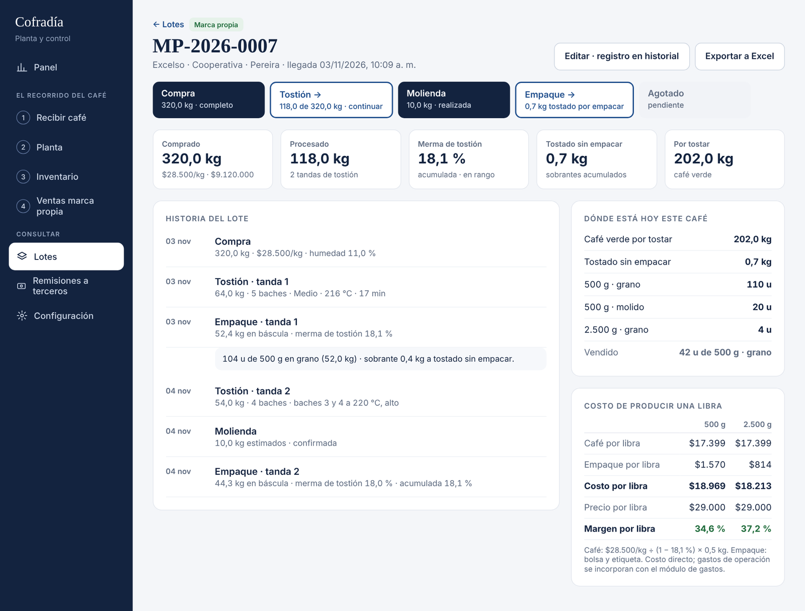

---

### B-13 · Insumos con precio real; costo por libra por presentación — Ola 2

**Precios vigentes confirmados por Cofradía:**

| Insumo | Precio |
| --- | --- |
| Bolsa 500 g | $1.200 |
| Etiqueta 500 g | $370 |
| Bolsa 2.500 g | $3.700 |
| Etiqueta 2.500 g | $370 |

**Costo de producir una libra** (por lote y presentación):
`costo café por libra = precio kg ÷ (1 − merma de tostión acumulada) × 0,5`
`costo empaque por libra = (bolsa + etiqueta) ÷ libras por bolsa` (500 g: $1.570 · 2.500 g: $4.070 ÷ 5 = $814)
`costo por libra = café + empaque` · `margen = (precio por libra − costo) ÷ precio por libra`

Ejemplo MP-2026-0007 (Excelso, $28.500/kg, merma 18,1 %): café $17.399 · 500 g $18.969 (margen 34,6 %) · 2.500 g $18.213 (margen 37,2 %).

Nota en pantalla: «Costo directo; los gastos de operación se incorporan con el módulo de gastos.»

---

### B-14 · Panel de gerencia orientado al dueño — Ola 2

**Debe quedar** (periodo Hoy / Semana / Mes):
- **KPIs (tres):** ingresos del mes (marca propia + servicios, variación vs. mes anterior) · **libras vendidas** vs. promedio mensual (2.850 lb, parametrizable; no hay meta) · margen bruto de marca propia.
- **Sin franja de inventario** (producto terminado, cobertura, valor a costo) y **sin por cobrar**. El detalle de inventario vive en Inventario (B-10).
- **Ingresos diarios (14 días):** barras apiladas marca propia / servicios, con el **total sobre cada barra** y leyenda. Sin doble eje. El acumulado va como dato en el encabezado.
- **Para decidir hoy:** presentaciones agotadas, insumos bajo mínimo, lotes listos sin recoger, proveedor fuera de rango. Sin cartera.
- **Libras vendidas por presentación:** mix 500 g / 2.500 g con libras, ingreso, margen por libra y margen.
- **Costo de producir una libra:** calidad × presentación, con margen.
- **Producción del mes (kg que entran a cada proceso):** Trilla · Tostión (marca propia / maquila) · Molienda (marca propia / maquila). **Sin empaque.** Merma de tostión de marca propia con su banda.
- **Proveedores de marca propia:** comprado (kg y $), precio/kg, humedad y merma con semáforo (gris en rango, ámbar fuera de rango).
- **Se retira:** merma de trilla y de maquila del panel (se consultan en cada lote), merma de empaque y molienda, la franja de inventario y todo lo de cuentas por cobrar.

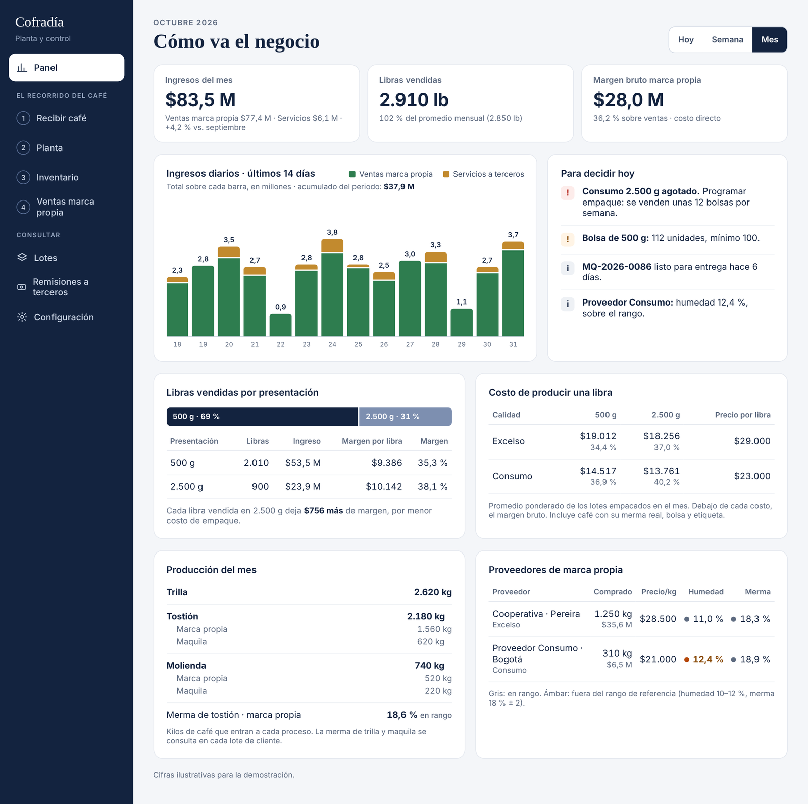

---

### B-16 · Edición de lotes por el administrador — Ola 1

**Hoy:** en la prueba, la edición del lote no guardó los cambios.

**Debe quedar:** lo especificado en A-18 de la v1. Prioridad alta: Cofradía necesita corregir los lotes de la prueba.

**Criterio:** [ ] El administrador corrige el peso recibido con motivo; se recalculan saldos, merma y costo por libra, y queda la traza.

---

### B-17 · Remisión impresa: regreso visible, sin merma total — Ola 1

**Hoy (vista `/print/remision/[id]`):**
- «volver a Planta» existe, pero como un enlace pequeño entre «solo original · con copia del cliente · 80 mm · 58 mm». El usuario no lo encuentra y queda atrapado en la vista de impresión.
- El tiquete muestra **merma de molienda** (ej.: 35,0 → 20,0 kg, 42,9 %) y una **«Merma total» de 60 %**. Molienda no tiene merma, y una «merma total» alta en un documento que se lleva el cliente genera desconfianza.
- Sigue apareciendo «1 bulto» y «Perfil pedido: medio».

**Debe quedar**
- Barra superior, **solo en pantalla** (`@media print { display:none }`): botón **«Imprimir con copia»** y botón **«Volver a Planta»**, del mismo tamaño. Debajo, selectores de formato: `Original` | `Con copia` y `80 mm` | `58 mm`. Texto: «Controles solo en pantalla; no se imprimen.»
- Tras cerrar el diálogo de impresión (`afterprint`), el foco queda en «Volver a Planta».
- Contenido del tiquete:
  - Llegada: fecha, hora y kg (sin bultos); humedad de trilla si aplica.
  - **Trilla**: kg entra → kg sale · merma de trilla.
  - **Tostión**: kg entra · «Perfil de tueste: Medio · 222 °C · 17 min» (uno por perfil si hay varios) · kg entra → kg en báscula · **merma de tostión**.
  - **Molienda**: kg molidos y valor. **Sin merma.**
  - **Empaque**: «Incluido» · bolsas del cliente (n × kg, forma) · **a granel** (kg, forma).
  - **Entregado** (kg) y **valor servicios**. **Sin «Merma total» y sin estado de pago.**
  - Quién recibe, cédula, firma, «Documento de control interno. No es factura electrónica.»
- Regla: entregado = kg en báscula de empaque (bolsas + granel). Si no cuadra con la salida de tostión, el problema está en el registro, no se imprime como merma.

**Criterios**
- [ ] El botón «Volver a Planta» se ve sin desplazarse y no aparece en el papel.
- [ ] Ningún tiquete muestra merma de molienda, de empaque ni «merma total».
- [ ] El ejemplo de 27,0 kg tostados → 22,1 kg (2 × 10,0 kg molido + 2,1 kg a granel) imprime merma de tostión 18,1 % y entregado 22,1 kg.

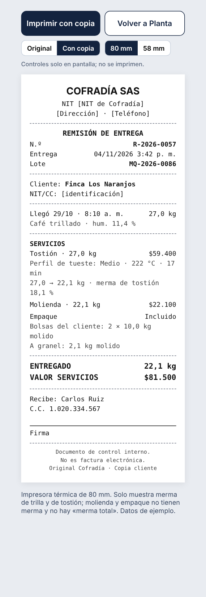

---

### B-19 · Planta sin fila de avisos — Ola 1

**Debe quedar:** Planta muestra solo la cola de trabajo (Por trillar · Por tostar · Por moler · Por empacar · Por entregar) y el resumen del día. Se elimina la fila de avisos de A-13 (merma, insumos, lotes sin recoger). Los avisos para decidir viven en el Panel.

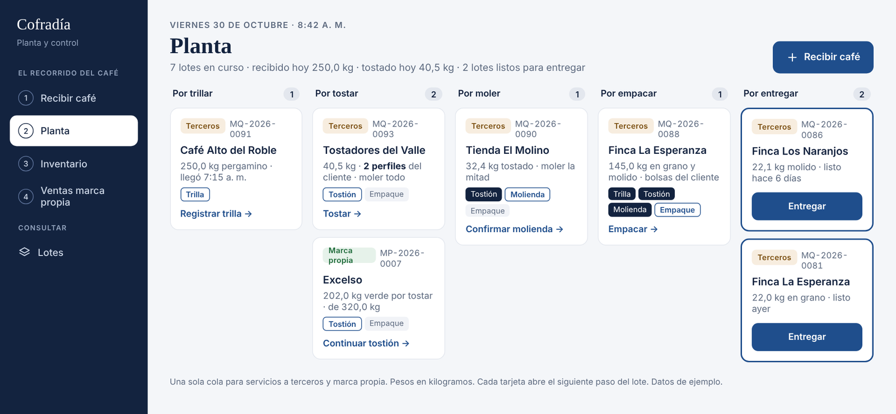

---

### B-20 · Glosario de tueste unificado — Ola 1

**Debe quedar:** aplicar el glosario de la sección 2 en todas las pantallas, la remisión impresa y Configuración.

| Antes | Después |
| --- | --- |
| «Receta Excelso» (rótulo en tostión) | No se muestra rótulo; la cabecera dice «Excelso · Medio · 216 °C · 17 min» |
| «Receta de tostión» | «Perfil de tueste» |
| «Perfil de tostión» (recepción) | «Perfil de tueste» |
| «Nivel» | «Nivel de tueste» |
| «Perfil pedido: medio» (remisión) | «Perfil de tueste: Medio · 222 °C · 17 min» |
| «Recetas de tueste» (Configuración) | «Perfiles de tueste por tipo de café» |
| «Calidad» en marca propia | «Tipo de café» |

**Criterio:** [ ] Buscar «receta» en el código de la interfaz no devuelve textos visibles al usuario.

---

## 6. Cambios de datos probables (validar contra el esquema)

| Ajuste | Cambio sugerido |
| --- | --- |
| B-01 | Retirar `bultos` y `peso_bulto` de la recepción (o dejarlos nullable y ocultos para no romper otros clientes). |
| B-02, B-18 | Tabla `perfil_tueste_tipo` (tipo_cafe, nivel, temp_c, tiempo_min, vigente_desde). Tabla `lote_perfil_tostion` (lote_id, orden, nivel, temp_c, tiempo_min, kg). |
| B-03, B-06 | En el lote: `molienda_solicitada_modo` (`todo`/`mitad`/`kg`/`ninguna`) y `molienda_solicitada_kg`. |
| B-04 | En el proceso de trilla: `humedad_pct`, `densidad_gl`. |
| B-05 | En el bache: `perfil_id`; peso de salida nullable y sin uso. En el proceso de tostión: `kg_entrada` por tanda. |
| B-07 | Proceso de molienda sin pesos; `confirmado_en`, `confirmado_por`. |
| B-08 | `empaque_linea` (v1) con `forma`; en el proceso de empaque: `peso_bascula_kg`, `sobrante_kg`, `tostion_proceso_id` al que se asigna la merma. Merma de tostión = f(entrada tanda, báscula). |
| B-09 | `inventario_tostado` (lote_id, calidad, forma, kg). |
| B-11 | Validación en servidor (función o constraint) que impida stock < 0 en ventas y cortesías. |
| B-14 | Parámetro `promedio_ventas_lb_mes` (2.850). Vista de ventas diarias por línea de negocio. |
| A-20 | **No crear** campos de pago (`estado_pago`, `pago_fecha`, `pago_medio`) en esta fase. |
| B-15 | `inventario_ajuste` (producto, delta, motivo, usuario, fecha, tipo `ajuste`/`carga_inicial`, costo_unitario nullable). |

---

## 7. Pruebas de punta a punta (v2)

1. **Marca propia por tandas.** Comprar 320,0 kg de Excelso a $28.500/kg → tostar 64,0 kg (perfil de Excelso, 216 °C) → empacar 104 bolsas de 500 g en grano, sobrante 0,4, báscula 52,4 (merma 18,1 %) → tostar 54,0 kg con baches 3 y 4 en Alto 220 °C → moler 10,0 kg → empacar en la tabla 500 g: 48 grano y 20 molido; 2.500 g: 4 grano; sobrante 0,3, báscula 44,3 → ficha: 202,0 kg por tostar, 0,7 kg sin empacar, merma 18,1 %, costo 500 g $18.969.
2. **Maquila con dos perfiles.** Recibir 50,0 kg pergamino con trilla, tostión (27,0 kg Medio 222 °C 17 min + 13,5 kg Alto 228 °C 18 min) y molienda «Mitad» → trilla con humedad y densidad → tostión con baches por perfil → confirmar molienda → empacar en grano y molido con bolsas del cliente → entregar sin paso de pago → remisión sin merma total → «Volver a Planta».
3. **Sin stock.** Intentar vender Consumo 2.500 g grano en cero → bloqueado; llevar Excelso 2.500 g molido al máximo → «+» deshabilitado.
4. **Ajuste.** Corregir el −3 de Consumo 2.500 g con «Ajustar inventario», motivo «conteo físico» → queda en auditoría.

---

## 8. Pendientes y riesgos

1. **Tarifa de molienda de terceros:** se propone liquidarla con los kg molidos empacados (B-07). Confirmar con Cofradía.
2. **Recalibrar la merma de referencia de tostión.** Al calcularla con la báscula de empaque, la merma incluye pérdidas de manipulación de molienda y empaque. Revisar la referencia (18 % ± 2) con 2 a 4 semanas de datos reales.
3. **Precio de la presentación de 2.500 g:** en los mockups se usa $145.000 (Excelso) y $115.000 (Consumo) como ilustración. Confirmar.
4. **Cuentas por cobrar y estado de pago** quedan para una fase posterior (A-20).
5. **Segunda sesión de pruebas** con Cofradía al cerrar la Ola 1, con las pruebas de la sección 7.
